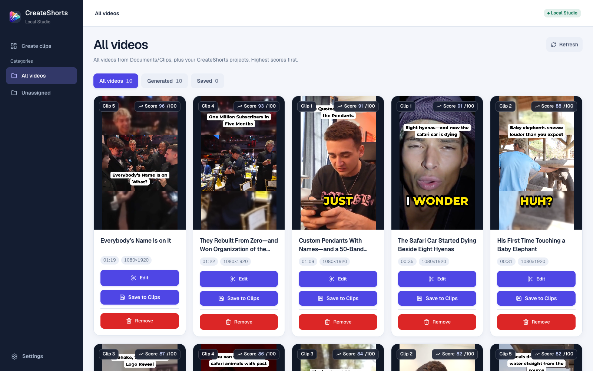
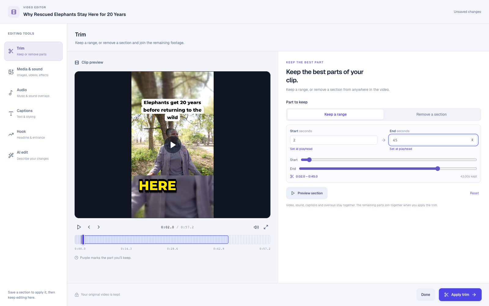
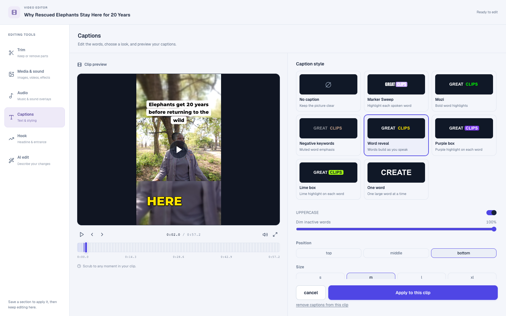
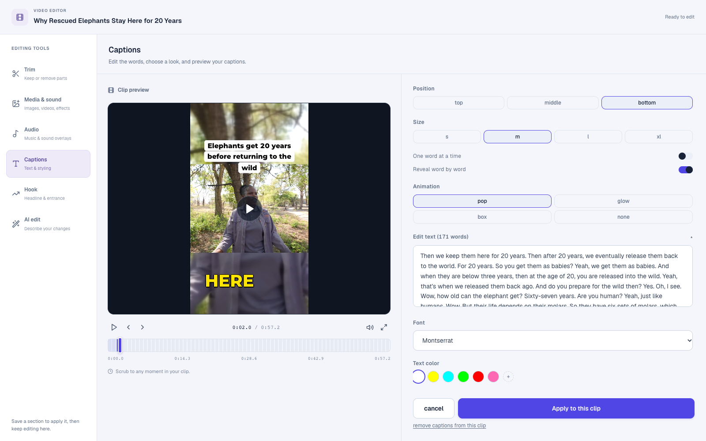
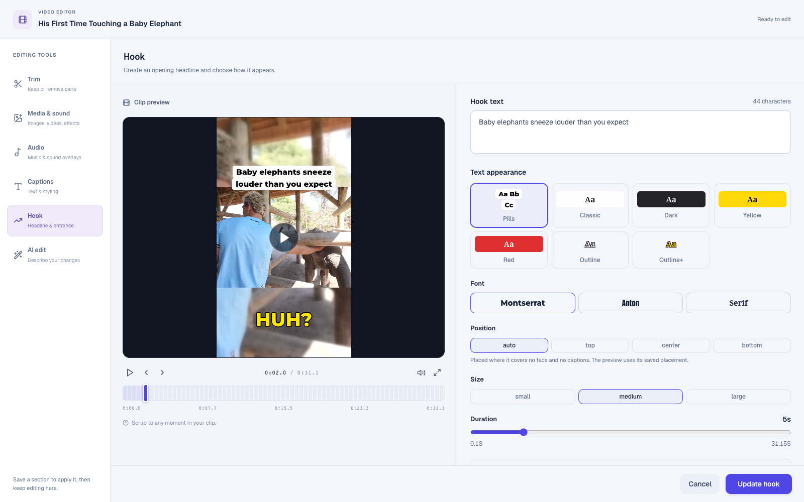
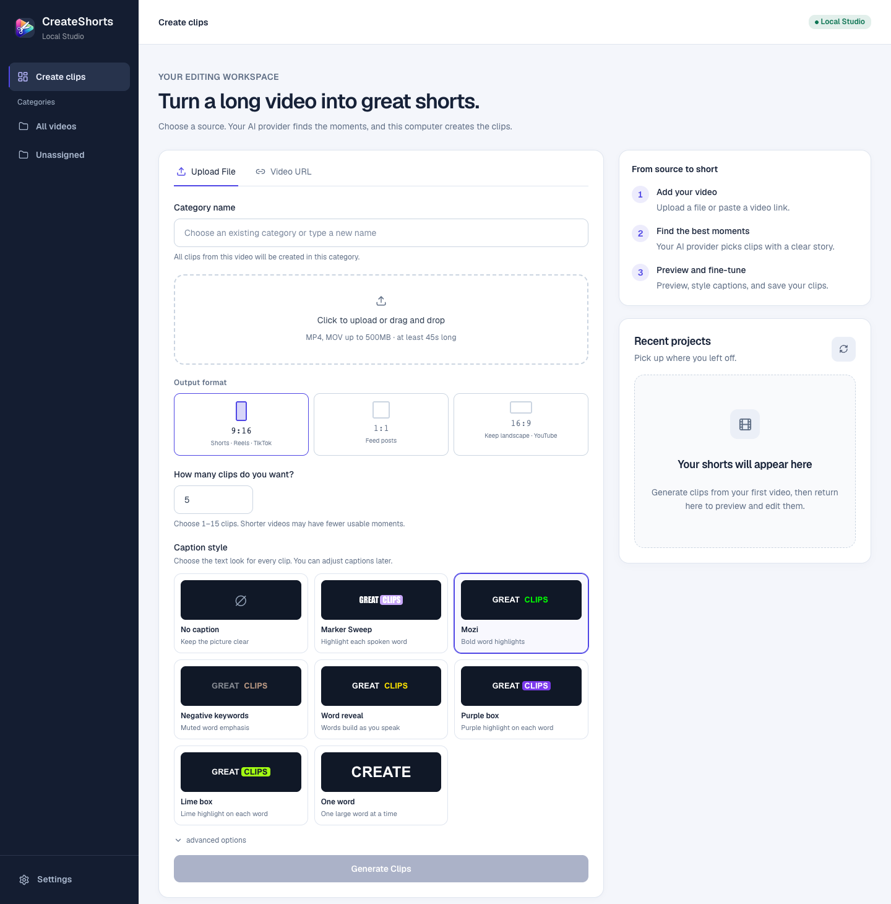
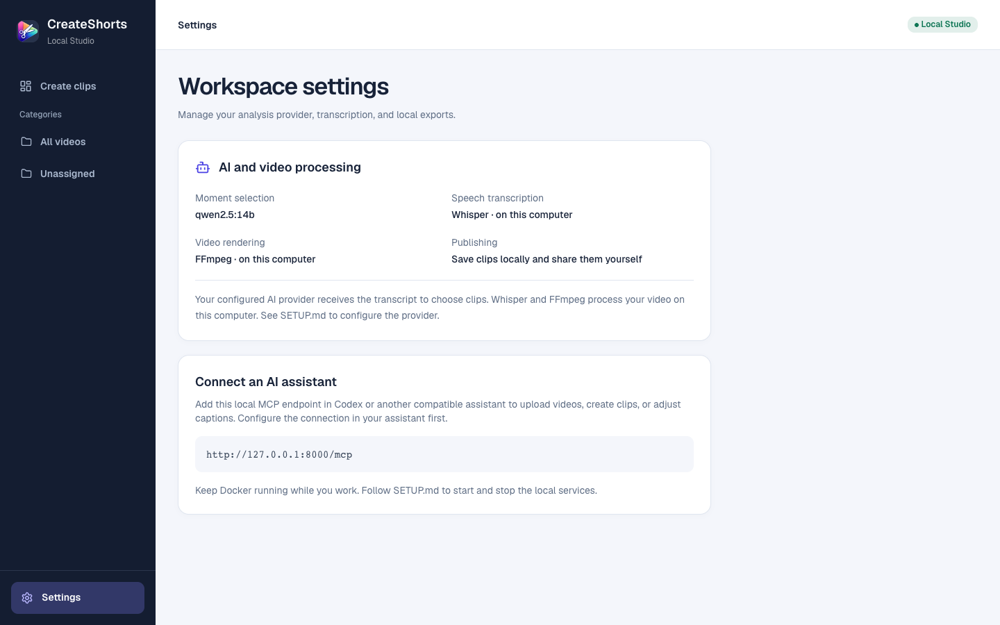

# CreateShorts

Turn long videos into short clips for YouTube Shorts, Instagram Reels, and TikTok.

Upload a video or paste a link, let AI choose the moments, then preview and edit your clips in a local workspace.

- Create vertical, square, or landscape clips.
- Add captions, hook text, images, and other edits.
- Organize videos into categories and save versions locally.
- Choose your AI provider and process video on your own computer.

## Screenshots

Real completed clips in the local workspace, from the video library to the editor.

**Video library with generated clips**

**Trim a clip and preview the selected range**

**Choose caption styles with a live preview**

**Edit the caption text**

**Add and style a hook**

**Create clips and choose a caption style**

**Workspace settings**

## Get started

Follow [SETUP.md](SETUP.md) to install the project, configure AI, run it with Docker, and publish your own copy to GitHub.

The dashboard opens at **http://localhost:5175**. AI services may need their own setup or API keys.

